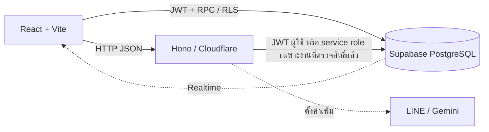

# FoodFlow (Plato)

ระบบบริหารร้านอาหารสำหรับพนักงาน: รับออเดอร์ → ครัว → เสิร์ฟ → รับชำระ พร้อมบัญชีคู่ สต็อก สมาชิก โปรโมชัน และรายงาน

[Fork สำหรับทำงาน](https://github.com/manatsawintho-ragoon/foodflow) / [ต้นฉบับ](https://github.com/Nol2way/foodflow) / [ติดตั้ง](docs/SETUP.md) / [สารบัญคู่มือ](docs/README.md)

## เริ่มใช้งาน

ใช้ Node.js ตาม `.nvmrc` (22.20.0) และ npm รันจากราก repository:

```powershell
npm --prefix frontend ci
npm --prefix backend ci
Copy-Item frontend/.env.example frontend/.env.local
Copy-Item backend/.dev.vars.example backend/.dev.vars
```

กรอกค่าตาม [SETUP](docs/SETUP.md) แล้วเปิดสอง terminal รัน `npm run dev:backend` และ `npm run dev:frontend`

หน้าเว็บ: <http://localhost:5173> / API: <http://localhost:8787/api/health> / Swagger: <http://localhost:8787/api/docs>

เครื่องนี้ใช้ `D:/foodflow/app` เป็น repository และ `D:/foodflow/docs` เป็นเอกสารต้นทาง มี local config อยู่แล้ว ไม่ต้องคัดลอกทับ ดู [ผลตรวจความพร้อม](docs/project-readiness.md)

## สถานะและขอบเขต

ผลหลังแก้ audit ดู [remediation results](docs/audits/2026-11-22-remediation-results.md), [คู่มือฟีเจอร์](docs/features.md) และ [operations](docs/operations.md) ส่วน project-readiness เป็นหลักฐานรอบเตรียมก่อนแก้

| ส่วน | มีในโค้ดปัจจุบัน | งานที่ยังต้องทำ |
|---|---|---|
| หน้าร้าน/ครัว | Add-ons, ผังโต๊ะ, แก้/แยกบิล, ค่าบริการ/ทิป, ticket 80 มม., PWA/คิว retry | UAT และเครื่องพิมพ์จริง; หารเท่ากันต้องเก็บครบก่อนปิดบิล |
| บัญชี/ภาษี/กะ | บัญชีคู่ เอกสารตาม order, exports/recovery และ HTTP API เพิ่ม | XML บน PostgreSQL ที่รองรับ และการยื่นเอกสารจริง |
| สต็อก | Ledger, FEFO/FIFO, สูตรซ้อน, blind count, AvT/yield/par, claim API | Restore drill และ LINE delivery จริง |
| สมาชิก/โปร | แต้ม/ledger, coupon/stack rules, export/delete/feedback | นโยบายเก็บข้อมูลและช่องทางติดต่อของร้านจริง |
| นำเข้า | CSV/XLSX, strict preview binding และ batch idempotency | ทดสอบกับไฟล์ร้านจริงก่อนย้ายประวัติ |
| ระบบกลาง | Session revocation/RLS, Swagger, CI, Dark/TH-EN และ audit log | หมุน secret, deploy migration และ production smoke test |
| AI | โค้ด Gemini และสถิติเดิม | ไม่อยู่ในรอบสองคน; router ไม่มี `/analytics` |

แผนหลักคือ [person-1](docs/tasks/2-people/person-1-pos-kitchen.md) และ [person-2](docs/tasks/2-people/person-2-crm-ops.md): คนละ 6 บั๊ก + 5 ฟีเจอร์ ส่วน [10 ระบบที่เสนอเพิ่ม](docs/tasks/2-people/proposed-systems.md) เป็นงานอนาคต

## สถาปัตยกรรม



- ล็อกอินผ่าน `/api/auth/login` ใช้ `app_users` และ bcrypt; backend ลงนาม HS256 JWT ด้วย legacy JWT secret **ไม่ได้ใช้ Supabase Auth สำหรับ login ปัจจุบัน**
- ผู้ใช้มีหลายบทบาทได้: owner, manager, staff, kitchen, accountant, stock ดู `frontend/src/lib/roles.ts`; RLS/RPC บังคับสิทธิ์จริง
- รับออเดอร์ผ่าน `staff_place_order`; ชำระผ่าน `counter_pay_bill`; เงินคำนวณในฐานข้อมูล
- สต็อกหยิบ FEFO คิดต้นทุน FIFO ใช้นับ/กลับรายการแทนแก้ยอดตรง ดู [stock](docs/stock.md)
- บัญชีใช้รายการคู่และ reversal ดู [accounting](docs/accounting.md)
- Worker รวมเว็บ+API+Cron ตั้งที่ `wrangler.jsonc`; Pages เป็นทางเลือกไม่มี Cron ไม่ถือว่า fork นี้ deploy แล้ว

## โครงสร้างและการตรวจงาน

`frontend/` = React/UI/tests / `backend/` = Hono/auth/OpenAPI/tests / `database/` = migrations/seed/tests / `docs/` = คู่มือ/ใบงาน

Migration ปัจจุบันคือ `0001-0011`; `archive/` เป็นประวัติ ห้ามรันซ้ำทั้งสองชุด ดู [migration guide](database/migrations/README.md)

```powershell
npm --prefix backend run typecheck
npm run test:backend
npm run build
npm run test:frontend
npm run openapi
```

DB/E2E ต้องเตรียมเพิ่มตาม [SETUP](docs/SETUP.md) อย่าใช้ฐานจริงทดลอง migration หรือ seed โดยไม่ตรวจผลกระทบ ห้ามใส่ service-role key/JWT secret ใน frontend หรือเอกสาร เก็บใน `backend/.dev.vars` ที่ Git ไม่ติดตาม ค่าจริงที่เคยอยู่ในเอกสารต้องเปลี่ยนตาม [คู่มือ Supabase API keys](https://supabase.com/docs/guides/getting-started/api-keys)
