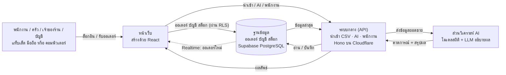
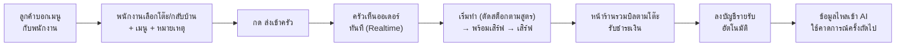
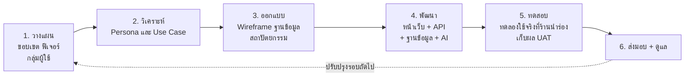

# FoodFlow (ฟู้ดโฟลว์)

**ระบบบริหารร้านอาหารครบวงจร: บัญชี · ออเดอร์ · สต็อก · AI คาดการณ์ยอดขาย**

🌐 [เปิดเว็บไซต์จริง](https://foodflow.pages.dev) · 📖 [คู่มือและเอกสารระบบ](https://foodflow.pages.dev/docs) · 🔌 [เอกสาร API (Swagger)](https://foodflow.pages.dev/api/docs) · 📦 [ซอร์สโค้ดบน GitHub](https://github.com/YOUR-USERNAME/foodflow)

> ⚠️ ลิงก์และชื่อโปรเจกต์ด้านบนเป็นค่าตัวอย่าง แก้ `YOUR-USERNAME`, โดเมน และชื่อระบบให้ตรงกับของจริงก่อนอัปโหลดขึ้น GitHub

---

## โครงงานนี้คืออะไร

**FoodFlow** คือระบบสำหรับร้านอาหารที่ช่วยให้เจ้าของร้านเลิก "นั่งดูตัวเลขเอง" พนักงานหน้าร้านรับออเดอร์แล้วกดส่ง ครัวเห็นออเดอร์ทันที ระบบลงบัญชีและตัดสต็อกให้อัตโนมัติ แล้วให้ **AI วิเคราะห์ข้อมูลยอดขายของร้าน** เพื่อบอกว่าช่วงไหนลูกค้าจะเยอะ ควรเตรียมวัตถุดิบเท่าไร และเมนูไหนกำไรดีหรือควรตัดออก

จุดเด่นของโครงงานคือ **"โยนข้อมูลเข้าไป แล้วให้ AI วิเคราะห์ให้"** เจ้าของร้านสามารถนำเข้ายอดขายเดิมจาก Excel/CSV ได้ทันที และถามระบบด้วยภาษาธรรมชาติ เช่น "เดือนที่แล้วเมนูไหนกำไรดีสุด?"

จัดทำในรายวิชา **(ใส่รหัสและชื่อวิชา)**

**ทีมผู้จัดทำ**

| ลำดับ | รหัสนักศึกษา | ชื่อ-นามสกุล | ตำแหน่ง |
|:-----:|:------------:|--------------|---------|
| 1 | (รหัส) | (ชื่อ-นามสกุล) | Project Manager |
| 2 | (รหัส) | (ชื่อ-นามสกุล) | Developer (Fullstack) |
| 3 | (รหัส) | (ชื่อ-นามสกุล) | Developer (Fullstack) |

---

## สถานะโครงการ

| ระบบ | สถานะ |
|------|:-----:|
| ออเดอร์ (พนักงานรับออเดอร์ → หน้าจอครัว → รับชำระ) | 🚧 รับออเดอร์ (ทานที่ร้าน/กลับบ้าน)/ครัว/รวมบิลตามโต๊ะเสร็จ รวมบิลมีส่วนลดโปรโมชัน · จัดการเมนู/โต๊ะในหน้าเว็บแล้ว |
| บัญชี (รายรับ-รายจ่าย, ต้นทุนต่อเมนู) | 🚧 รายรับ-รายจ่าย-กำไร-ต้นทุนต่อเมนูเสร็จ ยังไม่มีวิธีชำระเงิน ปิดยอดรายวัน ส่งออกรายงาน แก้/ลบรายจ่าย และ OCR |
| นำเข้าข้อมูล CSV | 🚧 นำเข้า/ตรวจก่อนนำเข้า/ย้อนการนำเข้าเสร็จ (ยังไม่รองรับ .xlsx โดยตรง ให้ Save As CSV) |
| วิเคราะห์ช่วงพีค/ออฟพีค + คาดการณ์รายชั่วโมง (สถิติ) | 🚧 เสร็จขั้นพื้นฐาน + สรุป/ถามตอบด้วย Gemini แล้ว ยังไม่มี Prophet / แจ้งเตือนความผิดปกติ / สรุปทุกเช้า |
| Backend (Cloudflare + Hono) | 🚧 นำเข้า CSV, AI, จัดการพนักงาน, Swagger (ทดสอบด้วย mock แล้ว รอทดสอบกับ Supabase จริง) |
| สต็อก (สูตรอาหาร, ตัดสต็อกอัตโนมัติ) | 🚧 รับเข้า/ของเสีย/เมนูหมด/สูตรอาหาร/ตัดสต็อกอัตโนมัติเสร็จ ยังไม่มีแจ้งเตือนนอกหน้าจอและแนะนำปริมาณสั่งซื้อ |

> ทุกส่วนยังไม่ได้ทดสอบกับ Supabase จริงและผู้ใช้จริง · รายละเอียดราย requirement: [docs/requirements.md](docs/requirements.md)

---

## ความสามารถของระบบ

สัญลักษณ์: ✅ ทำแล้ว · 🚧 ทำบางส่วน · 🔲 ยังเป็นแผน (รายการเต็มพร้อมหลักฐานอยู่ที่ [docs/requirements.md](docs/requirements.md))

### การรับออเดอร์ (พนักงานเท่านั้น ลูกค้าไม่ต้องใช้ระบบ)

- ✅ **หน้ารับออเดอร์ (`/pos`)** - เลือกทานที่ร้าน (เลือกโต๊ะ) หรือกลับบ้าน (ใส่ชื่อลูกค้า) → แตะเมนู → ส่งเข้าครัว
- ✅ **ราคาคิดที่ฐานข้อมูลเสมอ** - พนักงานแก้ยอดเงินหรือราคาในออเดอร์เองไม่ได้
- ✅ **หมายเหตุ** - รายเมนู เช่น "ไม่เผ็ด" และหมายเหตุทั้งออเดอร์ถึงครัว · 🔲 ตัวเลือกแบบมีราคา (เพิ่มไข่ดาว)
- ✅ **โต๊ะเดียวสั่งเพิ่มได้หลายรอบ** - แต่ละรอบเป็นใบสั่งใหม่เข้าครัว หน้าร้านรวมบิลให้ตามโต๊ะ
- 🚧 **เมนูหมดสั่งไม่ได้** - เมื่อตั้งเป็น "หมด" (หน้ารับออเดอร์เห็นทันที) · ปิดเมนูอัตโนมัติเมื่อวัตถุดิบไม่พอ 🔲
- 🔲 โหมดสว่าง/มืด และสลับไทย/อังกฤษ

### สำหรับเจ้าของร้าน / พนักงาน

- ✅ **หน้าจอครัว (KDS)** - ออเดอร์เข้าแบบเรียลไทม์ เปลี่ยนสถานะได้ และวัดเวลาทำต่อออเดอร์
- ✅ **หน้าร้าน** - รวมบิลตามโต๊ะ รับชำระเมื่อเสิร์ฟครบ ยกเลิกออเดอร์ที่ครัวยังไม่เริ่ม
- ✅ **ระบบบัญชี** - รายรับจากออเดอร์ที่ชำระแล้วอัตโนมัติ รายจ่าย 5 หมวด กำไร-ขาดทุน วันนี้/7/30 วัน (คำนวณในฐานข้อมูลตามเขตเวลาร้าน) · 🔲 วิธีชำระเงิน ปิดยอดรายวัน ส่งออกรายงาน
- ✅ **ต้นทุนต่อเมนู** - food cost % และกำไรต่อจานจากสูตรอาหาร
- ✅ **ระบบสต็อก** - รับเข้า ของเสีย สูตรอาหาร ตัดสต็อกอัตโนมัติ ไฮไลต์ของใกล้หมดในหน้าสต็อก · 🔲 แจ้งเตือนนอกหน้าจอ วันหมดอายุ
- ✅ **นำเข้ายอดขายจาก CSV** - ตรวจก่อนนำเข้า ย้อนการนำเข้าได้ · 🔲 ไฟล์ .xlsx โดยตรง
- ✅ **จัดการพนักงาน** - เพิ่ม/เชิญทางอีเมล (พนักงานตั้งรหัสผ่านเองจากลิงก์) เปลี่ยนบทบาท นำออก · ลืมรหัสผ่าน
- ✅ **จัดการเมนู (`/menu`)** - เพิ่ม/แก้/ปิดขายเมนู ราคา หมวด · โต๊ะ (เจ้าของ) · 🔲 รูปเมนู
- ✅ **โปรโมชัน (`/promotions`)** - ลด % หรือบาท ทั้งบิลหรือเฉพาะเมนู ซื้อขั้นต่ำ ช่วงวันที่ วันในสัปดาห์ ช่วงเวลา (เช่น ลดช่วงออฟพีค) พนักงานเลือกใช้ตอนรับออเดอร์ ฐานข้อมูลตรวจเงื่อนไขและคิดส่วนลดเอง · บัญชีแสดงยอดส่วนลด
- 🔲 สแกนบิลซื้อของ (OCR)

### ด้าน AI

- ✅ **วิเคราะห์ช่วงพีค/ออฟพีค** รายชั่วโมงและรายวัน จากสถิติของร้านเอง
- ✅ **คาดการณ์ออเดอร์รายชั่วโมง** ของวันในสัปดาห์ที่เลือก (ค่าเฉลี่ยวันเดียวกันย้อนหลัง)
- ✅ **เมนูขายดี** และ **สรุป/ถาม-ตอบภาษาไทยด้วย Gemini** จากตัวเลขที่คำนวณแล้ว พร้อมแสดงตัวเลขที่ใช้
- 🔲 แนะนำปริมาณสั่งซื้อวัตถุดิบ · เตือนความผิดปกติของต้นทุน · สรุปรายงานทุกเช้า · แนะนำตารางพนักงาน · โมเดล Prophet และวัดความแม่นยำ (backtest)

> **หลักการออกแบบ:** ตัวเลขคาดการณ์คำนวณด้วยโมเดลสถิติ (แม่นยำและตรวจสอบได้) แล้วให้ LLM ทำหน้าที่ **อธิบายผลเป็นภาษาคน** ไม่ให้ LLM เดาตัวเลขเอง

---

## ระบบทำงานอย่างไร

ระบบแบ่งเป็น 4 องค์ประกอบหลัก: ส่วนติดต่อผู้ใช้ (Frontend) ระบบกลาง (Backend API) ฐานข้อมูล (Database) และส่วนวิเคราะห์ AI



## เส้นทางของ 1 ออเดอร์



---

## เทคโนโลยีที่ใช้

| ส่วน | เทคโนโลยี | ทำหน้าที่อะไร |
|------|-----------|----------------|
| หน้าเว็บ | **React + TypeScript + Vite** | สร้างหน้าเว็บที่ลื่น เปลี่ยนหน้าโดยไม่ต้องโหลดใหม่ทั้งหน้า |
| ความสวยงาม | **Tailwind CSS** | จัดสไตล์หน้าเว็บให้สม่ำเสมอ รองรับโหมดมืด |
| ระบบกลาง (API) | **Hono บน Cloudflare Pages Functions / Worker** + **Swagger (OpenAPI 3.1)** | กันบอท จำกัดความถี่ นำเข้า CSV เรียก AI จัดการพนักงาน ถือความลับฝั่งเซิร์ฟเวอร์ |
| ฐานข้อมูล | **Supabase (PostgreSQL)** | เก็บออเดอร์ บัญชี สต็อก พร้อม Row Level Security |
| ออเดอร์เรียลไทม์ | **Supabase Realtime** | ส่งออเดอร์จากมือถือลูกค้าไปหน้าจอครัวทันที |
| ระบบสมาชิก | **Supabase Auth** | สมัคร/เข้าสู่ระบบสำหรับเจ้าของร้านและพนักงาน |
| พยากรณ์ยอดขาย | **SQL + TypeScript** (แผน: Python + Prophet) | ค่าเฉลี่ยวันเดียวกันย้อนหลัง ตรวจสอบย้อนกลับได้ |
| สรุปผล/ถามตอบ | **Gemini API** (ผ่าน backend) | อธิบายผลวิเคราะห์เป็นภาษาไทย ตอบคำถามเกี่ยวกับร้าน จากตัวเลขที่คำนวณแล้ว |
| ที่อยู่เว็บ | **Cloudflare Pages** | วางเว็บไซต์ กระจายทั่วโลก |
| ตัวช่วยทีม | **Git + GitHub** | เก็บประวัติโค้ด ทำงานร่วมกันเป็นทีม |

---

## ความปลอดภัยของระบบ

- 🔐 **แยกข้อมูลแต่ละร้านด้วย Row Level Security** - ร้านหนึ่งมองไม่เห็นข้อมูลของอีกร้าน ควบคุมที่ชั้นฐานข้อมูล
- 🧑‍💼 **แบ่งบทบาท 6 ระดับ** - เจ้าของ / ผู้จัดการ / พนักงานหน้าร้าน / ครัว / พนักงานบัญชี / พนักงานสต็อก เห็นและแก้ไขข้อมูลได้ไม่เท่ากัน บังคับที่ฐานข้อมูล (ดูตารางสิทธิ์ด้านล่าง)
- 🔑 **ความลับไม่อยู่ในหน้าเว็บ** - service role key และ Gemini API key อยู่ฝั่ง backend เท่านั้น (ดู [docs/api.md](docs/api.md))
- 🔒 **บิลที่ชำระแล้วยกเลิกไม่ได้** - ยกเว้นเจ้าของร้านพร้อมเหตุผล ทุกการยกเลิกบันทึกผู้ทำ เวลา และสถานะก่อนยกเลิก สถานะออเดอร์เดินหน้าตามลำดับเท่านั้น
- 🧾 **ออเดอร์แก้ยอดเงินไม่ได้** - สร้างออเดอร์ได้เฉพาะผ่านฟังก์ชันในฐานข้อมูล (ราคาจากเมนู) พนักงานเปลี่ยนได้แค่สถานะ ผู้ไม่ล็อกอินเข้าถึงข้อมูลร้านไม่ได้เลย
- 📦 **สต็อกไม่ติดลบ** - ฐานข้อมูลมีกฎห้ามสต็อกติดลบ และประวัติสต็อกแก้/ลบย้อนหลังไม่ได้ (การปิดเมนูเมื่อวัตถุดิบไม่พอยังต้องทำเอง)
- 💾 **สำรองข้อมูล** - 🔲 ยังไม่ได้ตั้งค่า (ดูข้อแนะนำใน [docs/requirements.md](docs/requirements.md))
- 🛡️ **PDPA** - เก็บข้อมูลลูกค้าเท่าที่จำเป็น (ดูรายละเอียดใน [docs/analysis-design.md](docs/analysis-design.md))

---

## บทบาทและสิทธิ์

ลูกค้าไม่ต้องใช้ระบบ พนักงานแต่ละคนมี 1 บทบาทต่อร้าน เจ้าของ (หรือผู้จัดการ สำหรับบทบาทที่ต่ำกว่า) เป็นผู้กำหนด

| ข้อมูล / การกระทำ | เจ้าของ | ผู้จัดการ | หน้าร้าน | ครัว | บัญชี | สต็อก |
|-------------------|:-------:|:--------:|:--------:|:----:|:-----:|:-----:|
| รับออเดอร์ส่งเข้าครัว / รับชำระเงิน / ยกเลิกก่อนครัวเริ่ม | ✅ | ❌ | ✅ | ❌ | ❌ | ❌ |
| ยกเลิกบิลที่ชำระแล้ว (ต้องใส่เหตุผล) | ✅ | ❌ | ❌ | ❌ | ❌ | ❌ |
| ดูออเดอร์ | ✅ | ❌ | ✅ | ✅ | ✅ (ดูยอด) | ❌ |
| เลื่อนสถานะ รอครัว → กำลังทำ → พร้อม → เสิร์ฟ | ✅ | ❌ | ✅ | ✅ | ❌ | ❌ |
| ตั้งเมนูหมด / เปิดขายอีกครั้ง | ✅ | ✅ | ✅ | ✅ | ❌ | ✅ |
| **จัดการเมนู ราคา หมวดเมนู** | ✅ | ✅ | ❌ | ❌ | ❌ | ❌ |
| จัดการโต๊ะ | ✅ | ❌ | ❌ | ❌ | ❌ | ❌ |
| **จัดการโปรโมชัน** | ✅ | ✅ | เลือกใช้ตอนรับออเดอร์ | ❌ | ❌ | ❌ |
| รายรับ-รายจ่าย / งบกำไร-ขาดทุน | ✅ | ❌ | ❌ | ❌ | ✅ | ❌ |
| วัตถุดิบ รับเข้า / ของเสีย / สูตรอาหาร | ✅ | ❌ | ❌ | บันทึกของเสียได้ | ดูอย่างเดียว | ✅ |
| คาดการณ์ / วิเคราะห์ลูกค้า (พีค/ออฟพีค) / ถาม AI | ✅ | ❌ | ❌ | ❌ | ✅ | ❌ |
| **นำเข้ายอดขาย CSV / ย้อนการนำเข้า** | ✅ | ✅ | ❌ | ❌ | ❌ | ❌ |
| **จัดการพนักงาน** (เพิ่ม/เชิญ เปลี่ยนบทบาท นำออก) | ✅ ทุกบทบาท | ✅ เฉพาะหน้าร้าน ครัว บัญชี สต็อก | ❌ | ❌ | ❌ | ❌ |

> ผู้จัดการแต่งตั้ง แก้ หรือนำออก เจ้าของและผู้จัดการคนอื่นไม่ได้ และเปลี่ยนบทบาทตัวเองไม่ได้ (กันเลื่อนสิทธิ์ตัวเอง) · ผู้จัดการเห็นเฉพาะออเดอร์ที่มาจากการนำเข้า ไม่เห็นออเดอร์จริงและบัญชี

> สิทธิ์ทั้งหมดบังคับที่ฐานข้อมูลใน [`0003_roles.sql`](database/migrations/0003_roles.sql) [`0005_import_and_hardening.sql`](database/migrations/0005_import_and_hardening.sql) และ [`0007_staff_ordering.sql`](database/migrations/0007_staff_ordering.sql), [`0008`](database/migrations/0008_order_status_rules.sql) และ [`0009_manager_promotions.sql`](database/migrations/0009_manager_promotions.sql) backend ตรวจซ้ำอีกชั้น การซ่อนเมนูในหน้าเว็บเป็นเพียงความสะดวกของผู้ใช้

---

## ขั้นตอนการพัฒนา (SDLC)

ทีมพัฒนาแบบ **ทำเป็นรอบ (Iterative)** เริ่มจากร้านนำร่องใช้งานจริงให้เร็วที่สุด แล้ววนปรับปรุงตามข้อมูลจริง



| เฟส | สิ่งที่ทำ |
|-----|-----------|
| 0. ตรวจสอบความต้องการ | สัมภาษณ์เจ้าของร้าน 3-5 ร้าน ขอข้อมูลยอดขายจริง เลือกร้านนำร่อง |
| 1. ออกแบบ | ER diagram, wireframe, ออกแบบ multi-tenant |
| 2. ออเดอร์ + เมนู | หน้ารับออเดอร์ของพนักงาน, หน้าจอครัว, รวมบิลตามโต๊ะ |
| 3. ระบบบัญชี | รายรับ-รายจ่าย, ต้นทุนต่อเมนู, งบกำไร-ขาดทุน |
| 4. นำเข้าข้อมูล + AI | นำเข้า CSV, คาดการณ์ยอดขาย, สรุปรายเช้า |
| 5. ทดลองใช้จริง | ติดตั้งที่ร้านนำร่อง แก้บั๊ก สะสมข้อมูล |
| 6. ระบบสต็อก | สูตรอาหาร, ตัดสต็อกอัตโนมัติ, แนะนำการสั่งซื้อ |
| 7. เตรียมขาย | ความปลอดภัย, PDPA, ระบบสมัครและชำระเงินรายเดือน |

---

## โครงสร้างโฟลเดอร์

โปรเจกต์แบ่งเป็น 4 ส่วนชัดเจน

```
foodflow/
├── frontend/              # หน้าเว็บ (React + TypeScript + Vite + Tailwind)
│   ├── src/               #   pages/ components/ lib/
│   ├── public/            #   ไฟล์สาธารณะ + sample-sales.csv
│   ├── functions/api/     #   Cloudflare Pages เรียก backend ที่ /api/*
│   ├── tests/             #   ทดสอบฟังก์ชันวิเคราะห์ช่วงพีค
│   └── .env.example
├── backend/               # API (Hono บน Cloudflare) + Swagger
│   ├── src/               #   app.ts (routes) · openapi.ts (Swagger) · ai.ts · csv.ts · supabase.ts · guards.ts
│   ├── test/              #   ชุดทดสอบ endpoint, CSV, Swagger
│   ├── scripts/           #   ส่งออก docs/openapi.json
│   ├── wrangler.toml
│   └── .dev.vars.example
├── database/              # PostgreSQL (Supabase)
│   ├── migrations/        #   0001_schema → 0018 รันตามลำดับเลข
│   ├── seed/              #   ข้อมูลตัวอย่าง + ข้อมูลทดลองย้อนหลัง
│   └── tests/             #   ทดสอบ RLS/สิทธิ์/ออเดอร์/สต็อก/บัญชี/นำเข้า บน Postgres จริง
├── docs/                  # เอกสารทั้งหมด (SETUP, API, Swagger JSON, ออกแบบ, ทดสอบ, ประเมินผล)
├── package.json           # คำสั่งรวม: install:all, dev:frontend, dev:backend, test
└── README.md
```

---

## เอกสารประกอบโครงงาน

| เอกสาร | เนื้อหา |
|--------|---------|
| [docs/requirements.md](docs/requirements.md) | requirement ทั้งหมด สถานะ หลักฐาน และสิ่งที่ควรทำต่อ |
| [docs/SETUP.md](docs/SETUP.md) | วิธีติดตั้ง รัน และ deploy ทั้ง 3 ส่วน |
| [docs/api.md](docs/api.md) | เอกสาร API: endpoint สิทธิ์ ข้อผิดพลาด ตัวแปร |
| **Swagger UI** `/api/docs` | ทดลองเรียก API ได้จริง (spec: [docs/openapi.json](docs/openapi.json)) |
| [docs/analysis-design.md](docs/analysis-design.md) | วิเคราะห์และออกแบบ: Persona · Use Case · ER Diagram · Sequence · Architecture |
| [docs/development.md](docs/development.md) | กระบวนการพัฒนา เครื่องมือ โครงสร้างโค้ด Git workflow และ milestones |
| [docs/testing.md](docs/testing.md) | แผนการทดสอบ Test Case และผลทดสอบ |
| [docs/evaluation.md](docs/evaluation.md) | ผลประเมินระบบและความพึงพอใจผู้ใช้ |

## รันบนเครื่องตัวเอง (ย่อ)

```bash
git clone https://github.com/YOUR-USERNAME/foodflow
cd foodflow
npm run install:all

# 1) ฐานข้อมูล: รัน database/migrations/0001 → 0018 ใน Supabase SQL Editor
# 2) backend (หน้าต่างที่ 1)
cd backend && cp .dev.vars.example .dev.vars && npm run dev    # http://localhost:8787/api/docs = Swagger
# 3) frontend (หน้าต่างที่ 2)
cd frontend && cp .env.example .env && npm run dev             # http://localhost:5173
```

รายละเอียดเต็ม: [**docs/SETUP.md**](docs/SETUP.md) · ทดสอบทั้งหมด: `npm test`

### การอัปเดตเว็บจริง (deploy)

| ส่วน | วิธี deploy |
|------|-------------|
| frontend + backend แบบ Cloudflare Pages (แนะนำ) | Root directory = `frontend`, Build command = `npm run build:pages` แล้ว push ขึ้น `main` ได้ทั้งเว็บและ `/api` อัตโนมัติ |
| backend แบบ Worker แยก (ทางเลือก) | **ต้องสั่งเองทุกครั้ง:** `cd backend && npm run deploy` |
| database | รัน migration ใหม่ใน Supabase SQL Editor ตามลำดับเลข |

> ⚠️ ถ้าใช้ Worker แยก จะไม่อัปเดตตาม GitHub อัตโนมัติ ถ้าแก้ endpoint แล้วลืม deploy หน้าเว็บจริงจะเรียก API ไม่เจอ (404)

---

© 2026 FoodFlow · โครงงานรายวิชา (ใส่ชื่อวิชา)
