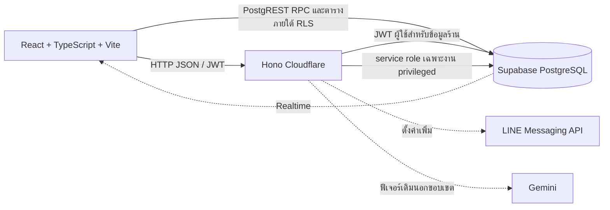
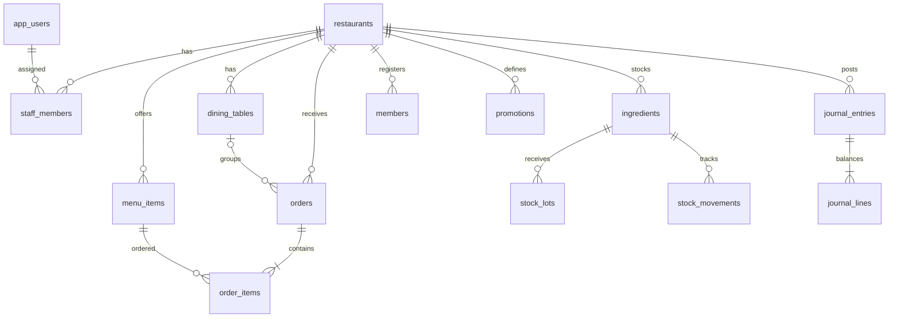
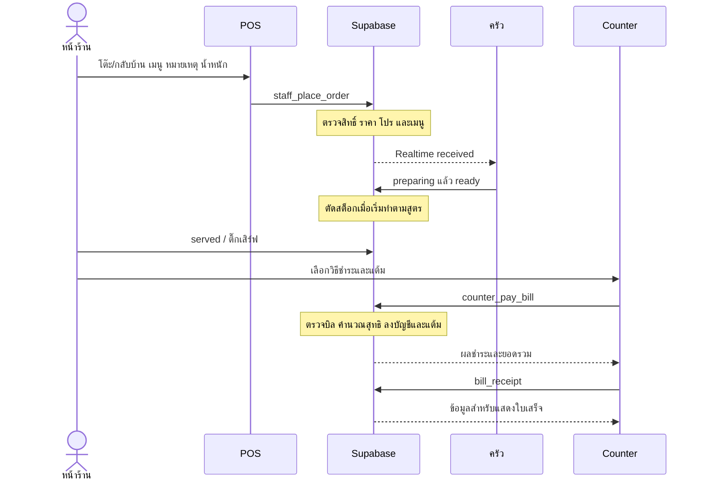

# วิเคราะห์และออกแบบ FoodFlow ตามโค้ดปัจจุบัน

## เป้าหมายและผู้ใช้

รวมการทำงานหน้าร้าน ครัว บัญชี และสต็อกให้เชื่อมกัน พนักงานรับออเดอร์ให้ลูกค้า ลูกค้าไม่ล็อกอินและยังไม่มีหน้าสั่งเอง ระบบแบ่งข้อมูลตามร้านด้วย restaurant_id/RLS แต่ UI ปัจจุบันเลือกใช้ร้านแรกที่ผู้ใช้สังกัด ไม่ถือว่าเป็นระบบบริหารหลายสาขาครบแล้ว

ทีมรอบนี้มีสองโดเมน Fullstack ตาม [ใบงาน](tasks/2-people/README.md) ไม่เพิ่มระบบ AI; โค้ด Gemini/สถิติเดิมเป็นตัวเลือก ส่วนข้อเสนอ 10 ระบบเป็นงานอนาคต

## ความต้องการและสถานะ

รายละเอียดรหัส FR/NFR และหลักฐานอยู่ใน [requirements](requirements.md) เป้าหมายเวลาตอบสนอง/Realtime, รองรับมือถือ, RLS, ความถูกต้องของเงิน/สต็อก ต้องวัดจาก test และ UAT ไม่ถือว่าเป้าหมายคือผลวัดแล้ว แบบประเมินยังต้องเก็บข้อมูลจริงใน [evaluation](evaluation.md)

Persona เดิมเป็นตัวอย่าง ยังไม่มีหลักฐานสัมภาษณ์ในชุดนี้ ผู้ใช้หลักที่โค้ดรองรับคือเจ้าของ ผู้จัดการ หน้าร้าน ครัว บัญชี สต็อก ไม่ใส่ชื่อบุคคล/ร้านหรือผลสัมภาษณ์สมมติเป็นข้อเท็จจริง

## สถาปัตยกรรมและ authentication

ผู้ใช้เก็บใน `app_users` รหัสผ่าน bcrypt ล็อกอินผ่าน `/api/auth/login` → `app_login` → backend ลงนาม HS256 JWT ด้วย legacy JWT secret ของ Supabase หน้าเว็บเก็บ session และแนบ JWT ให้ API/PostgREST/Realtime ฐานข้อมูลอ่าน auth.uid() จาก sub

ไม่ใช้ Supabase Auth login/อีเมลเชิญแบบคู่มือเดิม พนักงานใหม่ได้รหัสชั่วคราวผ่านเจ้าของ/ผู้จัดการและ UI พาไปเปลี่ยนรหัส (backend ไม่ได้บังคับ must_change_password ทุก endpoint) มีหนึ่งคนหลายบทบาทใน staff_members API ตรวจ app_user_active แต่การใช้ JWT ตรงกับฐานต้องตรวจนโยบายแยก ไม่กล่าวว่าเปลี่ยน/ปิดบัญชี revoke ทุก token ทุกช่องทางแล้ว

## โครงสร้างข้อมูลหลัก

แผนภาพเป็นเฉพาะความสัมพันธ์หลัก ไม่ใช่ทุกตาราง รายละเอียดจริงใช้ [migrations 0001–0008](../database/migrations/README.md), [บัญชี](accounting.md), [สต็อก](stock.md) ไม่รัน archive ร่วมกับชุดรวม

## เส้นทางออเดอร์

ห้ามถือการ PATCH status เป็น paid ตรงว่าเป็น flow ที่ถูกต้อง ช่องโหว่นี้ยังอยู่ใน P1-B1 ต้องปิดก่อนใช้ production งาน P1-B4/P2-B3 เกี่ยวกับเงิน/แต้มยังเปิดอยู่

## สิทธิ์

| งาน/หน้า | บทบาทที่หน้าเว็บเปิดให้ |
|---|---|
| POS, Serve, Counter | owner, staff |
| Kitchen | owner, staff, kitchen; เริ่ม/เสร็จทำอาหารเฉพาะ owner/kitchen ตาม SQL |
| Accounting | owner, accountant, manager; manager อ่านและปิดวันตามสิทธิ์ ไม่มีฟอร์มรายจ่าย |
| Stock overview/history/receive/variance/yield | owner, manager, stock, accountant; accountant อ่านอย่างเดียว |
| Stock count/setup | owner, manager, stock |
| Menu, Promotions, Import, Members, Staff | owner, manager |
| Report | owner, manager, accountant |
| Settings | owner |

ตารางนี้อิง `lib/roles.ts` ไม่แทน RLS/RPC ผู้จัดการกำหนด role owner/manager ไม่ได้; ยกเลิกบิล paid เฉพาะ owner พร้อมเหตุผลและกติกาภาษีใน 0008 จอ display ใช้ `/display/:token` เป็นลิงก์สาธารณะเฉพาะร้าน ต้องรักษา token นั้น

## เงิน สต็อก และข้อมูลส่วนบุคคล

ราคา/ส่วนลด/แต้มคำนวณใน DB สต็อกเป็น ledger และล็อต FEFO/FIFO ยอดแก้ตรงไม่ได้ การยกเลิกต้องพิจารณาการคืนล็อตและบัญชีตาม [accounting](accounting.md) และ [stock](stock.md) ไม่ใช้คำอธิบาย waste/prep/ถัวเฉลี่ยจาก inventory-seafood แบบเดิมเป็น flow ปัจจุบัน

ชื่อรับกลับบ้านเป็นข้อมูลเสริม สมาชิกมีข้อมูลติดต่อ/แต้ม; หน้า privacy, export/delete member และ feedback ยังเป็น P2-F2 ไม่อ้างว่าทำ PDPA ครบแล้ว การประเมินข้อกฎหมายต้องแยกจากการตรวจโค้ด

## AI และบริการอนาคต

มีฟังก์ชันสถิติใน SQL/TypeScript และ API Gemini เดิม ต้องตั้ง key จึงทำงานได้ ไม่มีหน้า `/analytics`, ไม่มี Python Forecast Service หรือ Prophet deployment ใน repo นี้ ไม่มีผล backtest/UAT ยืนยันความแม่นยำตามเอกสาร

## หลักฐานการตรวจ

[project-readiness](project-readiness.md) บันทึกสิ่งที่รันจริง แยกจากผลเก่าใน testing และแยกจากเป้าหมายในใบงาน รายงานรายวิชาต้องอ้างหลักฐานตาม [course-context](course-context.md)
