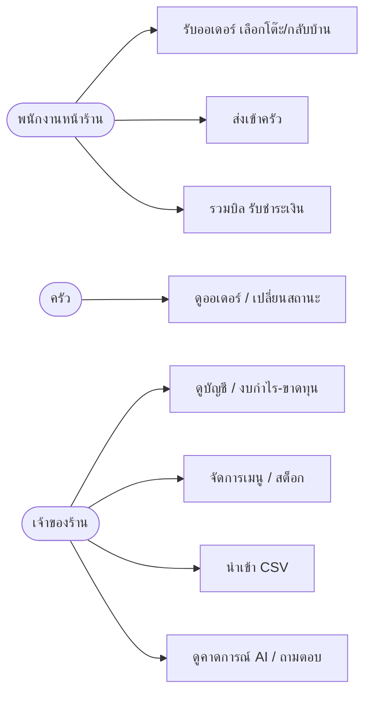
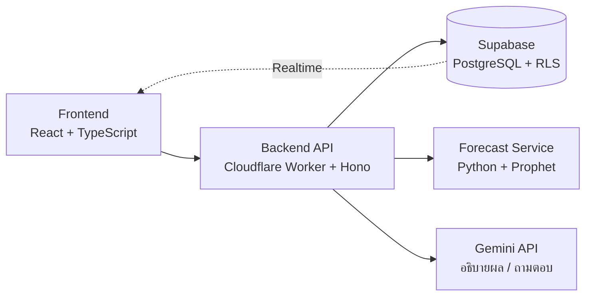
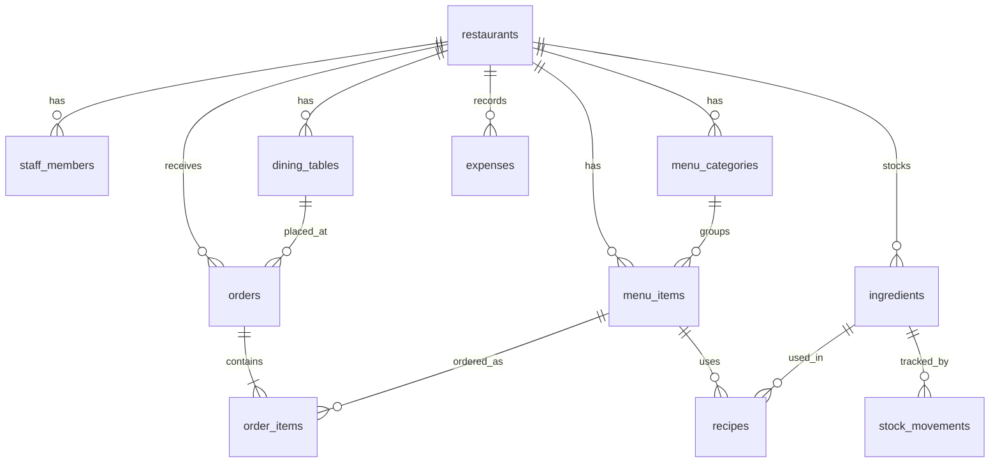
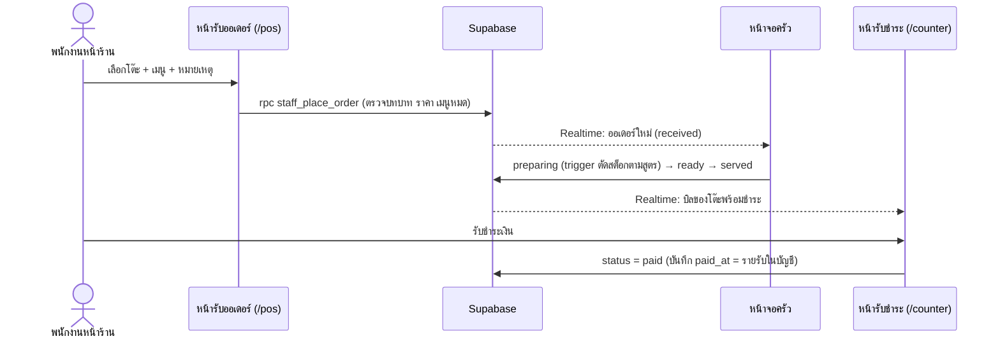

# เอกสารวิเคราะห์และออกแบบระบบ FoodFlow

## 1. ภาพรวมปัญหา

เจ้าของร้านอาหารขนาดเล็ก-กลางส่วนใหญ่ต้องจดบัญชีเอง นับสต็อกเอง และคาดเดาเองว่าช่วงไหนคนจะเยอะ ทำให้เตรียมของไม่พอหรือเหลือทิ้ง และไม่รู้ว่าเมนูไหนกำไรจริง

**เป้าหมายของระบบ:** รวมออเดอร์ บัญชี และสต็อกไว้ที่เดียว แล้วใช้ AI วิเคราะห์ข้อมูลแทนที่เจ้าของร้านต้องนั่งดูเอง

## 2. Persona

| Persona | รายละเอียด | ความต้องการหลัก | ความเจ็บปวด |
|---------|-----------|-----------------|--------------|
| **คุณสมศรี** เจ้าของร้านตามสั่ง (45 ปี) | ขายเอง มีพนักงาน 2-3 คน ใช้มือถือเป็นหลัก | รู้กำไรจริงแต่ละวัน ไม่ต้องจดสมุด | ไม่รู้ว่าเมนูไหนกำไร ของเสียบ่อย |
| **พี่ต้น** หัวหน้าครัว (30 ปี) | คุมการทำอาหารทั้งหมด | เห็นออเดอร์ชัดเจน ไม่ตกหล่น | ออเดอร์จดมือสับสนช่วงคนเยอะ |
| **น้องเมย์** ลูกค้า (22 ปี) | นั่งทานที่ร้าน ใช้มือถือ | สั่งเองได้เร็ว รู้ว่าอาหารถึงไหนแล้ว | รอพนักงานรับออเดอร์นาน |

> ⚠️ Persona ข้างต้นเป็นตัวอย่าง ควรแทนที่ด้วยข้อมูลจากการสัมภาษณ์เจ้าของร้านจริงในเฟส 0

## 3. ความต้องการของระบบ

### 3.1 Functional Requirements

| รหัส | ความต้องการ | ความสำคัญ |
|------|-------------|:---------:|
| FR-01 | พนักงานหน้าร้านรับออเดอร์ (ทานที่ร้าน/กลับบ้าน) แล้วส่งเข้าครัว ลูกค้าไม่ต้องใช้ระบบ | สูง |
| FR-02 | ครัวเห็นออเดอร์แบบเรียลไทม์และเปลี่ยนสถานะได้ | สูง |
| FR-03 | ระบบบันทึกรายรับจากออเดอร์อัตโนมัติ | สูง |
| FR-04 | บันทึกรายจ่ายแยกหมวด และดูงบกำไร-ขาดทุน | สูง |
| FR-05 | คำนวณต้นทุนและกำไรต่อเมนู | กลาง |
| FR-06 | นำเข้ายอดขายจาก CSV/Excel | สูง |
| FR-07 | AI คาดการณ์ช่วงเวลาที่ลูกค้าเยอะและยอดขาย | สูง |
| FR-08 | AI สรุปรายงานและตอบคำถามเป็นภาษาไทย | กลาง |
| FR-09 | ตัดสต็อกอัตโนมัติตามสูตรอาหาร | กลาง |
| FR-10 | แจ้งเตือนของใกล้หมด/ใกล้หมดอายุ | กลาง |
| FR-11 | สแกนบิลซื้อของด้วย OCR | ต่ำ |
| FR-12 | แยกสิทธิ์เจ้าของร้าน/พนักงาน และแยกข้อมูลแต่ละร้าน | สูง |

### 3.2 Non-Functional Requirements

| รหัส | ความต้องการ |
|------|-------------|
| NFR-01 | ออเดอร์ขึ้นหน้าจอครัวภายใน 2 วินาที |
| NFR-02 | ใช้งานบนมือถือได้ทุกขนาดจอ |
| NFR-03 | ข้อมูลแต่ละร้านแยกกันที่ชั้นฐานข้อมูล (RLS) |
| NFR-04 | สอดคล้อง PDPA เก็บข้อมูลลูกค้าเท่าที่จำเป็น |
| NFR-05 | ตัวเลขคาดการณ์ต้องตรวจสอบย้อนกลับได้ ไม่ให้ LLM เดาตัวเลข |

## 4. Use Case

## 5. สถาปัตยกรรม

**หลักการสำคัญ**
- หน้าเว็บคุยกับฐานข้อมูลโดยตรงได้เฉพาะการอ่านที่ RLS อนุญาต การเขียนที่ต้องตรวจสอบ (สร้างออเดอร์ ตัดสต็อก) ทำผ่าน API เท่านั้น
- ตัวเลขพยากรณ์มาจากโมเดลสถิติ แล้วส่งตัวเลขนั้นให้ LLM เรียบเรียงเป็นภาษาคน

## 6. ER Diagram

โครงสร้างตารางจริงอยู่ที่ [`database/migrations/`](../database/migrations)

## 7. Sequence: สั่งอาหารจนลงบัญชี

## 8. ส่วน AI

| ความสามารถ | วิธีทำ | ข้อมูลที่ใช้ |
|------------|--------|--------------|
| คาดการณ์ช่วงคนเยอะ / ยอดขาย | Prophet (ฤดูกาลรายวัน/สัปดาห์ + วันหยุด) | `orders` รายชั่วโมง |
| ตรวจความผิดปกติ | เทียบค่าเฉลี่ยเคลื่อนที่ + เกณฑ์ % | `expenses`, `stock_movements` |
| วิเคราะห์เมนูขายดี/ไม่ดี | คำนวณกำไรต่อเมนูด้วย SQL | `order_items`, `recipes`, `ingredients` |
| สรุปรายเช้า / ถามตอบ | ส่งตัวเลขที่คำนวณแล้วให้ LLM เรียบเรียง | ผลลัพธ์จากด้านบน |

**ข้อควรระวัง:** ต้องมีข้อมูลย้อนหลังพอสมควร (แนะนำอย่างน้อย 4-8 สัปดาห์) การคาดการณ์จึงเริ่มน่าเชื่อถือ ระบบควรแสดงช่วงความไม่แน่นอนและแจ้งผู้ใช้เมื่อข้อมูลยังน้อย

## 9. PDPA

- เก็บเฉพาะข้อมูลที่จำเป็น: ลูกค้าไม่ต้องใช้ระบบหรือสมัครสมาชิก ชื่อ/เบอร์สำหรับสั่งกลับบ้านไม่บังคับ (ไม่เกิน 50 ตัวอักษร)
- ข้อมูลพนักงาน/เจ้าของร้านเก็บผ่าน Supabase Auth
- ส่งให้ LLM เฉพาะข้อมูลสรุปทางธุรกิจ ไม่ส่งข้อมูลส่วนบุคคลของลูกค้า
- มีหน้านโยบายความเป็นส่วนตัวและช่องทางขอลบข้อมูล (ทำก่อนเปิดขายจริง)

## 10. บทบาทและสิทธิ์ (Authorization)

ระบบใช้ 5 บทบาทสำหรับพนักงาน (`owner`, `staff`, `kitchen`, `accountant`, `stock`) และลูกค้าที่ไม่ต้องล็อกอิน

| ข้อมูล / การกระทำ | เจ้าของ | หน้าร้าน | ครัว | บัญชี | สต็อก |
|-------------------|:-------:|:--------:|:----:|:-----:|:-----:|
| สร้างออเดอร์เอง / ยกเลิก / รับชำระเงิน | ✅ | ✅ | ❌ | ❌ | ❌ |
| ดูออเดอร์ | ✅ | ✅ | ✅ | ✅ (ดูยอด) | ❌ |
| เลื่อนสถานะ ใหม่ → กำลังทำ → พร้อม → เสิร์ฟ | ✅ | ✅ | ✅ | ❌ | ❌ |
| ตั้งเมนูหมด / เปิดขายอีกครั้ง | ✅ | ✅ | ✅ | ❌ | ✅ |
| แก้ไขเมนู ราคา โต๊ะ | ✅ | ❌ | ❌ | ❌ | ❌ |
| รายรับ-รายจ่าย / งบกำไร-ขาดทุน | ✅ | ❌ | ❌ | ✅ | ❌ |
| วัตถุดิบ รับเข้า / ของเสีย / สูตรอาหาร | ✅ | ❌ | บันทึกของเสียได้ | ดูอย่างเดียว | ✅ |
| คาดการณ์ / ดูวิเคราะห์ลูกค้า (พีค/ออฟพีค) | ✅ | ❌ | ❌ | ✅ | ❌ |
| จัดการสิทธิ์พนักงาน | ✅ | ❌ | ❌ | ❌ | ❌ |

**หลักการ**
- บังคับสิทธิ์ที่ชั้นฐานข้อมูล (RLS) ไม่เชื่อการซ่อนเมนูฝั่งหน้าเว็บ
- ครัวเปลี่ยนสถานะได้เฉพาะ received → served ส่วน `paid` และ `cancelled` เป็นของหน้าร้านและเจ้าของ
- ห้ามแก้ยอดสต็อกตรงๆ ต้องบันทึกผ่าน `stock_movements` (เพิ่มได้อย่างเดียว ไม่แก้/ลบ) เพื่อให้ตรวจสอบย้อนหลังได้
- ตัวอย่างข้อควรทำต่อ: หน้าจัดการพนักงานของเจ้าของ และบทบาท platform admin ตอนขายแบบ SaaS

## 11. ตัดสต็อกตามสูตรอาหารและต้นทุนต่อเมนู

- **สูตรอาหาร** (`recipes`): วัตถุดิบและปริมาณต่อ 1 จาน แก้ได้เฉพาะเจ้าของและพนักงานสต็อก และวัตถุดิบต้องอยู่ร้านเดียวกับเมนู
- **เวลาตัดสต็อก:** ครั้งแรกที่ออเดอร์เปลี่ยนเป็น `preparing` (หรือสถานะถัดไป) ตัดครั้งเดียวต่อออเดอร์ (`stock_deducted_at`) เมนูที่ไม่มีสูตรจะไม่ตัดอะไร
- **สต็อกไม่พอ:** ตัดเท่าที่มี ไม่ขวางครัว เพราะอาหารถูกทำไปแล้วจริง (ยอดในระบบอาจคลาดเคลื่อน) ควรนับสต็อกจริงเป็นระยะแล้วปรับยอด
- **ออเดอร์ที่ยกเลิกหลังเริ่มทำ** ไม่คืนสต็อก (ถือเป็นของเสีย)
- **ต้นทุนต่อเมนู** (`menu_item_costs`): ผลรวม ปริมาณต่อจาน × ต้นทุนต่อหน่วย ไม่รวมค่าแรง ค่าเช่า ค่าน้ำไฟ ต้นทุนต่อหน่วยเป็นค่าที่กรอกเอง ไม่ใช่ราคาถัวเฉลี่ยจากการซื้อจริง

## 12. วิเคราะห์ช่วงพีค / ออฟพีค และคาดการณ์

**ข้อมูล:** จำนวนออเดอร์ (ไม่นับที่ยกเลิก) แยกตามวันในสัปดาห์ × ชั่วโมง ตามเขตเวลาของร้าน (`restaurants.timezone`) คำนวณใน `analytics_hourly` เฉพาะเจ้าของและพนักงานบัญชีเรียกได้ ไม่ใช้ข้อมูลส่วนบุคคลของลูกค้า

**การจัดระดับชั่วโมง:** เทียบกับค่าเฉลี่ยของชั่วโมงที่มีออเดอร์
- พีค = ตั้งแต่ 125% ของค่าเฉลี่ย · ออฟพีค = ไม่เกิน 50% (เกณฑ์ตัวอย่าง ปรับได้ใน `src/lib/analytics.ts`)
- ออฟพีคนับเฉพาะช่วงที่ร้านเปิดจริง (ตั้งแต่ชั่วโมงแรกถึงชั่วโมงสุดท้ายที่มีออเดอร์)

**คาดการณ์:** ค่าเฉลี่ยของวันเดียวกันในสัปดาห์ย้อนหลัง (14/28/56 วัน) ต้องมีวันเดียวกันอย่างน้อย 2 ครั้งจึงแสดง และเตือนเมื่อข้อมูลสะสมน้อยกว่า 14 วัน

**ข้อจำกัด:** ไม่รวมวันหยุดพิเศษ ฝน หรือโปรโมชัน, ถ้าร้านปิดบางวันในช่วงที่นับ ค่าเฉลี่ยจะต่ำกว่าจริง, ยังไม่มี backtest เทียบกับยอดจริง (ดู TC-P4 ใน testing.md) และเป็นค่าประมาณ ไม่ใช่การรับประกัน

