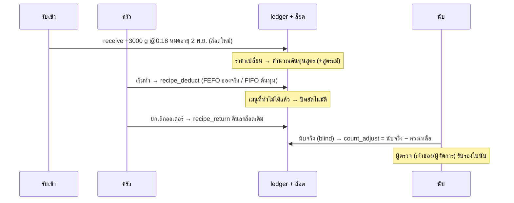

# โมดูลสต็อกวัตถุดิบ FoodFlow

การเปลี่ยนแปลงรอบ audit/P1/P2: [features](features.md) · การปล่อยและทดสอบ: [operations](operations.md) · [ผล verification](audits/2026-11-22-remediation-results.md)


ฐานข้อมูลใช้ `0005_stock.sql` สำหรับ ledger ล็อต สูตรและสิทธิ์ ใช้ `0007_order_cancel_kitchen.sql` สำหรับสิทธิ์ตามสถานะออเดอร์ และ `0008_fix_accounting_stock.sql` สำหรับเงื่อนไขใบลดหนี้ก่อนยกเลิกบิลที่ชำระแล้ว

API อยู่ใน `backend/src/stock.ts` (Swagger แท็ก “สต็อกวัตถุดิบ”) สูตรฝั่งหน้าเว็บอยู่ใน `frontend/src/lib/stockMath.ts` แบบออกแบบก่อนใช้ ledger เก็บไว้ใน [inventory-seafood.md](inventory-seafood.md)

## 1. หลักการ

| หลักการ | ทำอย่างไรในระบบ |
|---|---|
| สต็อกมีแค่ 3 แหล่ง | `receive` นำเข้า · `recipe_deduct` / `recipe_return` ตัด/คืนตามสูตร (อัตโนมัติจากออเดอร์) · `count_adjust` นับสุดท้าย |
| ไม่มีการบันทึกของเสียแยก | ของเสีย/ของหายทั้งหมดไปโผล่เป็น **ส่วนต่าง** ตอนนับ (ช่องเหตุผลในใบนับไม่บังคับ) |
| ยอดคงเหลือ = ผลรวม ledger | `ingredients.quantity_on_hand` เป็นยอดสะสมที่ trigger ดูแลและป้องกันการแก้โดยตรง (`stock_balance_is_ledger`) |
| แก้ย้อนหลังไม่ได้ | `stock_movements` append-only (`stock_ledger_append_only`) ผิดให้สร้าง **รายการกลับ** (`reverses_id` กลับได้ครั้งเดียว) |
| หยิบ FEFO คิดต้นทุน FIFO | ทุกการรับเข้าเป็นล็อต · ล็อตมี 2 ยอด: `qty_remaining` (ของจริงบนชั้น ตัดแบบหมดอายุก่อนออกก่อน) และ `fifo_remaining` (ชั้นต้นทุน ตัดแบบรับก่อนคิดก่อน) |
| สต็อกติดลบไม่ได้ | ตัดเกินคงเหลือ = ปฏิเสธทั้งรายการ (`insufficient_stock: <ชื่อ>`) |
| ของไม่พอปิดเมนูเอง | ทุกรายการ ledger ตรวจเมนูที่ใช้วัตถุดิบนั้น (รวมผ่านสูตรย่อย) ทำไม่ได้ 1 ที่ = ปิด (`stock_disabled`) ของกลับมาพอ = เปิดคืน · ปิดเองด้วยมือ ระบบไม่ไปเปิดให้ |

### Actual vs Theoretical (AvT)

```
ยอดที่ควรเหลือ = คงเหลือตาม ledger ก่อนปรับยอดนับ            (ตัดตามสูตรสุทธิหลังหักรายการคืน)
ส่วนต่าง      = นับจริง − ยอดที่ควรเหลือ                   (ติดลบ = ของหายไม่ทราบสาเหตุ)
ส่วนต่าง %    = ส่วนต่าง ÷ ยอดที่ควรเหลือ × 100
สี            เขียว |%| < 2 · เหลือง 2–5 · แดง > 5         (ควรเหลือ 0 แต่นับได้ไม่ตรง = แดง)
ติดลบต่อเนื่อง 3 รอบ = เตือน "สูตรหรือ yield อาจไม่ตรง"
```

### ต้นทุน และ Par

```
ต้นทุนต่อหน่วยที่ใช้ได้ = ราคาซื้อ ÷ (trim_yield × cook_yield)
วัตถุดิบดิบที่ตัด        = ปริมาณสุทธิในสูตร ÷ (trim_yield × cook_yield)
รอบสั่ง (วัน)           = 7 ÷ จำนวนวันที่ผู้ขายมาส่งต่อสัปดาห์      (ไม่มีผู้ขาย: lead 1 วัน รอบ 7 วัน)
Par                     = ใช้ต่อวัน × (lead time + รอบสั่ง) + safety stock   (ตั้ง par_level เองได้ มาก่อนค่าที่คำนวณ)
แนะนำสั่ง               = par − คงเหลือ (ไม่ติดลบ) ปัดขึ้นเป็นหน่วยซื้อ
ใช้ต่อวัน               = (ตัดตามสูตรสุทธิ + ส่วนต่างติดลบจากการนับ) ย้อนหลัง 28 วัน ÷ 28
แนะนำสั่ง "วันนี้"       = ถ้าสั่งวันนี้ ของจะมาถึง (วันนี้ + lead time) ตรงวันที่ผู้ขายมาส่ง
```

ราคาในใบรับเข้าเปลี่ยน → `ingredients.last_unit_cost` เปลี่ยน → trigger คำนวณ `recipes.cost_per_output` ใหม่ทุกสูตรที่ใช้วัตถุดิบนั้น **รวมสูตรแม่ทุกชั้น**

## 2. ตาราง

| ตาราง | คอลัมน์สำคัญ |
|---|---|
| `ingredients` | `recipe_unit` (g/ml/pcs หน่วยฐาน) · `purchase_unit` + `conversion_factor` · `display_unit` + `display_factor` (หน่วยที่ครัวพูด เช่น ถุง/ฟอง) · `trim_yield_pct` · `cook_yield_pct` (ข้าวหุงเกิน 100 ได้) · `abc_class` · `storage_location` + `shelf_order` · `par_level` · `safety_stock` · `reorder_level` (จุดใกล้หมด) · `supplier_id` · `last_unit_cost` · `is_active` |
| `suppliers` | `name` · `lead_time_days` · `delivery_days` (0=อาทิตย์ … 6=เสาร์) |
| `stock_lots` | `qty` · `qty_remaining` (FEFO) · `fifo_remaining` (FIFO) · `raw_unit_cost` (ราคาซื้อ/หน่วยฐาน) · `unit_cost` (หลังหัก yield) · `expiry_date` · `received_at` · `source` (receive/count/opening/return) |
| `stock_movements` | `type` (receive / recipe_deduct / recipe_return / count_adjust / legacy) · `qty` (= `change`) · `cost` (มูลค่า FIFO) · `unit_cost` · `ref_id` · `reverses_id` · `balance_after` · `created_by` · `created_at` |
| `stock_movement_lots` | รายการไหนใช้/เติมล็อตไหน (`basis` fefo/fifo) → คืนลงล็อตเดิมได้ตรง |
| `stock_receipts` + `stock_receipt_lines` | ผู้ขาย จำนวน ราคา · `pack_qty` · `pack_size` · `pack_price` · `expiry_date` · `prev_unit_cost` · `price_change_pct` · `prev_pack_size` · `pack_changed` · ข้อมูลตรวจรับเทียบบิลและยอดทวง |
| `recipes` + `recipe_lines` | `output_qty` + `output_unit` · `menu_item_id` (ว่าง = สูตรย่อย) · บรรทัด = `ingredient_id` **หรือ** `sub_recipe_id` (สูตรซ้อน ห้ามวนกลับ) · `cost_per_output` |
| `stock_counts` + `stock_count_lines` | `period` (daily/weekly/monthly/spot) · `counted_by` · `verified_by` · `counted_qty` · `opening_qty` · `received_qty` · `deducted_qty` · `expected_qty` · `variance_qty` · `variance_value` · `variance_pct` · `note` (ไม่บังคับ) |
| `yield_tests` | `kind` (trim/cook) · `trials` (ก่อน-หลัง 3 ครั้ง) · `avg_pct` · `applied` |

หน่วยฐานทุกตัวเลขของสต็อก สูตร ล็อต และใบนับ = `recipe_unit` (g / ml / pcs) · หน่วยซื้อและหน่วยครัวใช้ตอนกรอก/แสดงผล

## 3. ลำดับเหตุการณ์



- **ตัดสต็อก** เมื่อครัวหรือเจ้าของกด “เริ่มทำ” ระบบแตกสูตรย่อยลงไปถึงวัตถุดิบดิบ สำหรับของชั่งขาย ระบบตัดตามน้ำหนักจริงของวัตถุดิบที่ผูกไว้โดยไม่หาร yield
- **คืนสต็อก** เมื่อยกเลิกทั้งออเดอร์ที่ตัดแล้ว ระบบเพิ่ม `recipe_return` อ้างรายการตัดเดิม คืนลงล็อตเดิมทั้ง FEFO และ FIFO ครั้งเดียว และกลับต้นทุนขาย (Dr สต็อก / Cr ต้นทุนขาย) เจ้าของยกเลิกได้จาก `preparing`, `served` หรือ `paid` โดย `ready` ต้องไป `served` ก่อน บิลที่จ่ายแล้วต้องระบุเหตุผล ถ้ามี ABB/TAX ที่ยืนยันแล้ว ต้องยืนยันใบลดหนี้ครบยอดก่อน
- **ก่อนเริ่มทำ** เจ้าของและพนักงานหน้าร้านยกเลิกทั้งออเดอร์หรือยกเลิกบางเมนูได้ (`cancel_order_items`) ระบบคิดยอดบิลใหม่เมื่อยกเลิกบางส่วน ช่วงนี้ยังไม่มีการตัดสต็อก
- **นับ:** บันทึกแล้วปรับยอดทันที · ผู้จัดการรับรองใบที่ตัวเองนับไม่ได้ (เจ้าของทำได้ เผื่อร้านคนเดียว) · รับรองไม่เปลี่ยนตัวเลข เป็นการเซ็นยืนยัน
- **กลับรายการ:** เจ้าของ/ผู้จัดการ เฉพาะ `receive` และ `count_adjust` · ต้องมีเหตุผล · ใบรับที่ของถูกใช้ไปแล้วกลับไม่ได้ (`lot_already_used` ให้แก้ด้วยการนับ)
- **นับเจอเกินในวัตถุดิบที่ไม่มีล็อต:** สร้างล็อตใหม่ที่ราคาล็อตล่าสุด · ยอดแรกของวัตถุดิบลงบัญชีเป็นยอดยกมา (ทุน) ไม่ใช่ส่วนต่าง

## 4. เชื่อมกับบัญชี

บัญชีลงผลต่างของ `round(quantity_on_hand × cost_per_unit, 2)` โดย `cost_per_unit` คือค่าเฉลี่ยของชั้น FIFO ที่เหลือ (ปัด 7 ตำแหน่ง) ส่วนภาพรวมสต็อกรวม `fifo_remaining × raw_unit_cost` จากล็อต ใช้ `acct_stock_reconcile` ตรวจยอดบัญชี 1130 ดูรายละเอียดใน [คู่มือบัญชี](accounting.md)

| ประเภทรายการ | บัญชีคู่ |
|---|---|
| receive (มีใบรับ) | ใบรับของปิดรายการด้วยเงินสด/ธนาคาร/เจ้าหนี้ + ลูกหนี้ผู้ขาย (ของขาด) |
| receive กลับรายการ | ลูกหนี้ผู้ขาย (`claim`) |
| recipe_deduct / recipe_return | ต้นทุนขาย (`cogs`) |
| count_adjust | ส่วนต่างสต็อก (`variance`) · ยอดแรกของวัตถุดิบ = ยอดยกมา (`equity`) |

## 5. สิทธิ์ (RLS ใน `0005`)

| | เจ้าของ | ผู้จัดการ | พนักงานสต็อก | บัญชี | ครัว / หน้าร้าน |
|---|:-:|:-:|:-:|:-:|:-:|
| ดูภาพรวม รายงาน ประวัติ ล็อต | ✅ | ✅ | ✅ | ✅ อ่านอย่างเดียว | ❌ มองไม่เห็น |
| จัดการวัตถุดิบ ผู้ขาย สูตร หน่วย | ✅ | ✅ | ✅ | ❌ | ❌ |
| รับเข้า นับ yield test | ✅ | ✅ | ✅ | ❌ | ❌ |
| รับรองใบนับ กลับรายการ | ✅ | ✅ (ไม่ใช่ใบที่ตัวเองนับ) | ❌ | ❌ | ❌ |
| ตัดสต็อกผ่านออเดอร์ | กด “เริ่มทำ” | ❌ | ❌ | ❌ | ครัวกด “เริ่มทำ” ได้ |

ทุก policy ตรวจ `has_role(restaurant_id, ...)` ของร้านนั้น จึงแยกข้อมูลรายร้าน · ledger ล็อต ใบรับ ใบนับ yield test เขียนผ่านฟังก์ชันเท่านั้น (ตรวจกฎครบในธุรกรรมเดียว) · พนักงานบัญชีอ่านได้เพราะงบการเงินใช้มูลค่าสต็อก (ข้อยกเว้นจาก "เฉพาะ owner / manager / stock_staff" ในสเปก)

## 6. หน้าจอ

| หน้า | ทำอะไร |
|---|---|
| `/stock` ภาพรวม | มูลค่าสต็อก (FIFO) · หมด · ใกล้หมด · ล็อตหมดอายุหรือจะหมดภายใน 3 วัน · แนะนำสั่งวันนี้แยกตามผู้ขาย · เตือนสูตร/yield · เมนูที่ระบบปิด · นับล่าสุด |
| `/stock-receive` รับเข้า | เลือกผู้ขาย → จำนวน (หน่วยซื้อ) ขนาดบรรจุ ราคาต่อแพ็ค วันหมดอายุ · เตือนราคา/ขนาดบรรจุเปลี่ยนตั้งแต่ก่อนบันทึก · "ตามบิล" ถ้าได้ไม่ครบ (ยอดรอทวง) · ใบรับย้อนหลัง รายงานผู้ขาย |
| `/stock-count` นับสต็อก | blind (ไม่แสดงยอดในระบบ) · เรียงตามตำแหน่งจัดเก็บ · กรอง ABC · ปุ่ม +/- ใหญ่ เป็นหน่วยครัว + เศษหน่วยฐาน · เหตุผลไม่บังคับ · ร่างเก็บในเครื่อง · ใบนับย้อนหลัง + รับรอง |
| `/stock-variance` รายงานส่วนต่าง | เรียงตามมูลค่า · นับรอบก่อน + นำเข้า − ตัดตามสูตร = ควรเหลือ · ส่วนต่าง หน่วย / บาท / % · สี · ติดลบ 3 รอบ |
| `/stock-yield` Yield test | ชั่งก่อน-หลัง 3 ครั้ง (ตัดแต่ง หรือ ปรุงสุก) · ค่าเฉลี่ย · ตั้งเป็น yield ของวัตถุดิบได้ (ต้นทุนสูตรคำนวณใหม่) |
| `/stock-history` ประวัติ | กรองวัตถุดิบ วันที่ ผู้ทำรายการ ประเภท · กลับรายการ |
| `/stock-setup` ตั้งค่า | วัตถุดิบ (ยอดยกมาตอนสร้าง) · ผู้ขาย · สูตรเมนู + สูตรย่อย (ต้นทุนก่อนบันทึก) · เปิด/ปิดเมนูเอง · หน่วย · เกณฑ์ตรวจรับ |

## 7. การแปลงข้อมูลใน `0005_stock.sql`

ตารางนี้อธิบายการเปลี่ยน schema และข้อมูลเมื่อรัน `0005` หลัง `0004` ในชุดปัจจุบัน สำหรับการติดตั้งใช้ลำดับ `0001`–`0008` ใน [คู่มือติดตั้ง](SETUP.md) ไฟล์ `0027`–`0030` ใต้ `database/migrations/archive/` เก็บไว้อ้างอิงประวัติ

| ของเดิม | หลังย้าย |
|---|---|
| หน่วย kg / ลิตร | แปลงเป็น g / ml ทุกตาราง (ยอด จุดสั่ง ต้นทุน ประวัติ สูตร ใบรับ ใบนับ หน่วยแปลง) ด้วยตัวคูณเดียวกัน · มูลค่าไม่เปลี่ยน ไม่มีรายการบัญชีใหม่ · หน่วยเดิมเก็บเป็นหน่วยซื้อ/หน่วยครัว |
| หน่วยอื่น (ฟอง ตัว ขวด) | `recipe_unit = pcs` ชื่อหน่วยเดิมยังแสดง |
| `yield_pct` | → `trim_yield_pct` (`cook_yield_pct` = 100) · `yield_pct` ยังอ่านได้ = trim × cook |
| ยอดที่ไม่เคยผ่าน ledger | เติม 1 รายการ `legacy` "ยอดยกมา" ให้ ผลรวม ledger = คงเหลือ · ยอดคงเหลือทั้งหมดเป็นล็อตตั้งต้นที่ต้นทุนเดิม |
| ของเสีย / ผลิตของเตรียม | ประวัติเก็บเป็น `legacy` · สร้างใหม่ไม่ได้ (`produce_prep` → `prep_production_removed`) |
| ของเตรียม + `prep_components` | → สูตรย่อย (output = ผลิต 1 ถังได้) · สูตรเมนูที่ใช้ของเตรียม → บรรทัดสูตรย่อย |
| `recipes` (เมนู × วัตถุดิบ) | เก็บที่ `legacy_menu_recipes` (อ่านอย่างเดียว) · สร้างสูตรใหม่ 1 สูตรต่อเมนู (output 1 จาน) |
| ยกเลิกทั้งออเดอร์หลังเริ่มทำ | คืนสต็อกลงล็อตเดิมและกลับต้นทุนขายเมื่อสถานะอนุญาตให้ยกเลิก |
| ของไม่พอตอนเริ่มทำ | เดิม: ตัดเท่าที่มี · ใหม่: เริ่มทำไม่ได้ + เมนูถูกปิดตั้งแต่ของไม่พอ |
| ผู้ขาย (ข้อความในใบรับ) | สร้างแถว `suppliers` ให้ และผูก `stock_receipts.supplier_id` |
| รายงานส่วนต่างระหว่าง 2 ใบนับ (`stock_variance`) | → ส่วนต่างต่อใบนับ (`stock_variance_report`) |

ผู้เรียกแบบเดิมที่ส่ง `unit: 'kg'` ตอนสร้างวัตถุดิบ ระบบแปลงเป็นกรัมให้ (ยอด ต้นทุน จุดสั่ง คูณตาม) · ส่ง `reason: 'purchase' | 'sale' | 'adjustment'` ยังใช้ได้ภายในฟังก์ชัน แต่ผู้ใช้เขียน `stock_movements` ตรงไม่ได้แล้ว

รายงานรายวัน (`daily_report_data`) ยังอ่านรายการของเสียเดิมที่มีอยู่ งานสต็อกปัจจุบันบันทึกของเสียรวมในส่วนต่างจากการนับ

## 8. ข้อมูลตัวอย่างและการทดสอบ

- `seed_demo.sql`: ผู้ขาย 3 ราย · วัตถุดิบ 12 รายการ (หน่วยฐาน หน่วยซื้อ หน่วยครัว yield ABC ตำแหน่ง) · สูตรเมนู 5 เมนู + สูตรย่อย "น้ำจิ้มข้าวมันไก่"
- `seed_stock_demo.sql` (ไม่บังคับ): ใบรับย้อนหลัง (ล็อตใกล้หมดอายุ) · ใบนับ 3 รอบ หมูสับติดลบทุกรอบ (เห็นคำเตือนสูตร/yield) · yield test ⚠️ ลงบัญชีจริง อย่ารันกับร้านที่ใช้งานจริง
- `database/tests/test_stock.py` ครอบคลุม ledger, FEFO/FIFO, การคืนล็อต, การกลับรายการ, การปิดเมนู, การนับ, yield, par และสิทธิ์บน migrations ปัจจุบัน และทดสอบอัปเกรดข้อมูลรุ่นเดิมด้วยไฟล์ใน `migrations/archive/` ดูคำสั่งรันใน [แผนทดสอบ](testing.md)
- `frontend/tests/stock.test.ts`: สูตรส่วนต่าง สี ติดลบต่อเนื่อง FEFO FIFO yield par หน่วยครัว
- `backend/test/stock.test.ts`: สิทธิ์ การตรวจข้อมูล ข้อความไทยของข้อผิดพลาด การส่งต่อไปฐานข้อมูล
